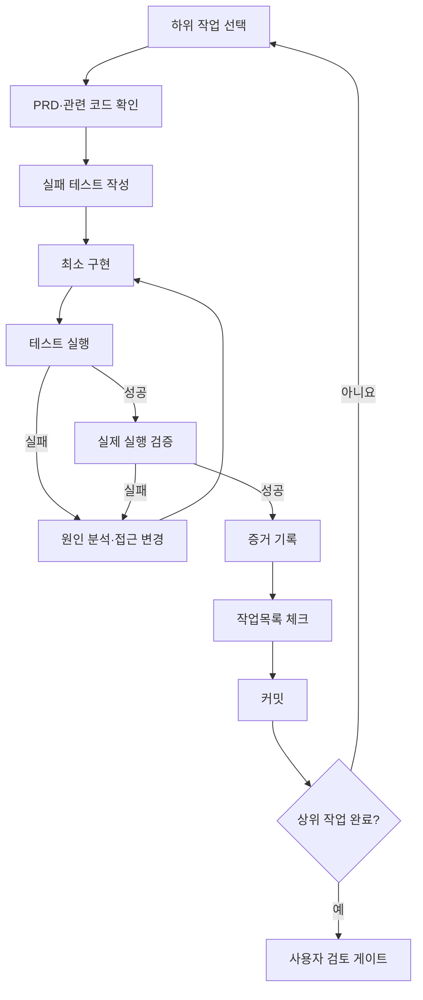
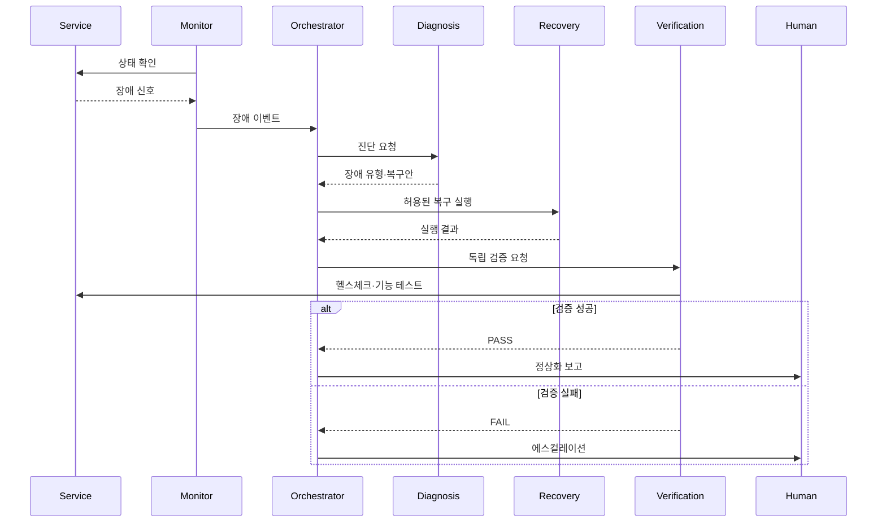

# PRD 기반 3-File System 방법론

## 멀티 에이전트 프로젝트를 아이디어에서 검증 가능한 서비스로 전환하는 개발 방식

---

## 1. 3-File System이란?

PRD 기반 3-File System은 AI 코딩 에이전트에게 한 번에 모든 개발을 맡기지 않고, 개발 과정을 세 개의 독립된 프롬프트 파일로 나누어 통제하는 방법론이다.

```text
01-create-prd.md
아이디어를 요구사항으로 구체화
        ↓
02-generate-tasks.md
요구사항을 검증 가능한 작업으로 분해
        ↓
03-process-task-list.md
작업을 코드·테스트·검증 단위로 실행
```

핵심 목적은 AI가 사용자 의도를 충분히 이해하지 못한 상태에서 곧바로 코드를 생성하는 문제를 줄이는 것이다.

> 먼저 무엇을 만들지 합의하고, 다음으로 어떻게 나눠 만들지 합의한 후, 마지막으로 한 단계씩 구현한다.

---

## 2. 왜 필요한가?

일반적인 AI 코딩은 다음과 같은 방식으로 시작되는 경우가 많다.

```text
아이디어 입력
→ AI가 요구사항을 추측
→ 여러 파일을 한꺼번에 수정
→ 일부 기능만 동작
→ 테스트와 완료 기준이 불명확
→ 수정할수록 구조가 복잡해짐
```

이 방식에서는 다음 문제가 발생한다.

- 사용자 요구사항과 구현 결과가 달라진다.
- 프로젝트 범위가 계속 확대된다.
- AI가 중요한 제약조건을 누락한다.
- 작업 순서와 의존성이 꼬인다.
- 코드를 작성했지만 실제 실행하지 않는다.
- 테스트 증거 없이 완료를 선언한다.
- 오류가 발생하면 같은 접근을 반복한다.

3-File System은 이러한 문제를 **요구사항 게이트, 작업분해 게이트, 실행·검증 게이트**로 통제한다.

---

## 3. 방법론의 기본 구조

| 단계 | 프롬프트 파일 | 핵심 질문 | 생성 산출물 |
|---|---|---|---|
| 요구사항 정의 | `01-create-prd.md` | 무엇을 왜 만드는가? | PRD |
| 작업 분해 | `02-generate-tasks.md` | 무엇을 어떤 순서로 구현하는가? | 작업목록 |
| 실행·검증 | `03-process-task-list.md` | 각 작업이 실제로 완료됐는가? | 코드·테스트·배포 결과 |

세 파일은 프로젝트 결과물이 아니라 **AI 에이전트의 행동을 통제하는 재사용 가능한 프롬프트**다.

실제 프로젝트 산출물은 별도로 생성한다.

```text
prompts/
├── 01-create-prd.md
├── 02-generate-tasks.md
└── 03-process-task-list.md

docs/
├── prd-auto-healing.md
├── architecture.md
└── verification-report.md

tasks/
└── tasks-auto-healing.md

src/
tests/
deploy/
```

---

# 4. File 1 — `01-create-prd.md`

## 4.1 목적

초기 아이디어를 구현 가능하고 검증 가능한 제품 요구사항 문서인 PRD로 전환한다.

AI는 아이디어를 받자마자 PRD를 작성하거나 코딩하지 않는다. 먼저 질문을 통해 빠진 내용을 확인한다.

## 4.2 주요 기능

- 문제와 사용자 정의
- 목표와 비목표 구분
- 기능 요구사항 도출
- 비기능 요구사항 도출
- 에이전트 역할과 권한 정의
- 장애·복구 시나리오 정의
- 사람 승인 조건 정의
- 배포·검증 기준 정의
- 3일 MVP 범위 조정

## 4.3 핵심 질문

```text
누구의 어떤 문제를 해결하는가?
정상적인 서비스 흐름은 무엇인가?
어떤 장애를 자동 복구할 것인가?
각 에이전트는 어떤 책임과 권한을 갖는가?
자동 실행과 사람 승인은 어디에서 나뉘는가?
복구 성공을 어떻게 검증할 것인가?
3일 동안 반드시 구현할 기능은 무엇인가?
구현하지 않을 것은 무엇인가?
```

## 4.4 출력 예시

```text
docs/prd-auto-healing.md
```

PRD에는 최소한 다음 내용이 포함된다.

1. 문제 정의
2. 사용자와 이해관계자
3. 목표와 비목표
4. 서비스 시나리오
5. 에이전트 구성
6. 협업 프로토콜
7. 장애 유형
8. 복구정책
9. 자율성과 사람 승인
10. 기능·비기능 요구사항
11. 테스트 및 검증 기준
12. MVP 범위

## 4.5 승인 게이트

다음 조건이 충족되기 전에는 작업목록을 만들지 않는다.

- [ ] 문제와 사용자가 명확하다.
- [ ] 포함 범위와 제외 범위가 구분됐다.
- [ ] 완료 기준이 측정 가능하다.
- [ ] 에이전트별 책임이 구분됐다.
- [ ] 위험한 행동의 승인 조건이 있다.
- [ ] 3일 안에 구현 가능한 범위다.
- [ ] 사용자가 PRD를 승인했다.

---

# 5. File 2 — `02-generate-tasks.md`

## 5.1 목적

승인된 PRD를 구현 순서와 검증 기준이 포함된 계층형 작업목록으로 변환한다.

## 5.2 주요 기능

- PRD와 기존 코드베이스 확인
- 상위 작업과 하위 작업 분리
- 작업 간 의존성 정의
- 작업별 수정 파일 예상
- 테스트 작업 포함
- 작업별 완료 기준 정의
- 3일 일정에 작업 배치

## 5.3 작업 분해 원칙

```text
설계
→ 실패 테스트 작성
→ 최소 구현
→ 단위 테스트
→ 통합 테스트
→ 실제 실행 검증
→ 문서화
→ 커밋
```

기능 구현과 테스트를 별개의 마지막 단계로 분리하지 않는다. 각 기능 작업 안에 해당 테스트를 포함한다.

## 5.4 작업 항목 예시

```markdown
- [ ] 3.2 Recovery Agent의 재시도 정책 구현
  - 목적: 일시적 HTTP 오류를 제한된 횟수만큼 복구한다.
  - 선행조건: 장애 이벤트 스키마와 진단 결과 형식
  - 대상 파일:
    - src/agents/recovery.py
    - tests/test_recovery.py
  - 하위 작업:
    - [ ] 최대 시도 횟수 실패 테스트 작성
    - [ ] 지수 백오프 구현
    - [ ] 시도 횟수 영속화
    - [ ] 최대 횟수 후 에스컬레이션 검증
  - 완료 기준:
    - 최대 3회까지만 실행된다.
    - 프로세스 재시작 후에도 횟수가 유지된다.
    - 3회 실패 후 자동 복구가 중단된다.
  - 검증 명령: `pytest tests/test_recovery.py`
```

## 5.5 2단계 승인 방식

AI가 처음부터 수십 개의 세부 작업을 생성하지 않도록 한다.

```text
1단계: 상위 작업 5~8개 제안
→ 사용자 검토·수정·승인

2단계: 승인된 상위 작업을 하위 작업으로 세분화
→ 최종 작업목록 승인
```

이 방식은 잘못된 방향의 상세 계획에 많은 시간을 사용하는 것을 방지한다.

## 5.6 출력 예시

```text
tasks/tasks-auto-healing.md
```

---

# 6. File 3 — `03-process-task-list.md`

## 6.1 목적

승인된 작업목록을 한 항목씩 구현하고, 테스트와 실행 증거를 확인한 뒤 완료 처리한다.

## 6.2 기본 실행 루프



## 6.3 한 번에 한 작업

AI는 여러 상위 작업을 동시에 구현하지 않는다.

```text
현재 하위 작업 선택
→ 관련 파일만 수정
→ 테스트
→ 검증
→ 작업목록 갱신
→ 다음 작업
```

이 원칙은 변경 범위를 줄이고 실패 원인을 추적하기 쉽게 만든다.

## 6.4 완료 정의

```text
완료 ≠ 코드 작성

완료 =
요구사항 충족
+ 테스트 통과
+ 실제 실행 확인
+ 결과 증거 기록
+ 작업목록 갱신
```

## 6.5 오류 처리 프로토콜

### 첫 번째 실패

- 오류 메시지를 그대로 확인한다.
- 원인을 진단한다.
- 최소한의 수정으로 해결한다.

### 두 번째 실패

- 같은 명령을 그대로 반복하지 않는다.
- 도구, 라이브러리 또는 접근 방식을 바꾼다.

### 세 번째 실패

- 초기 가정과 설계를 재검토한다.
- 작업목록이나 PRD 변경이 필요한지 판단한다.
- 해결할 수 없다면 구체적인 차단요인을 사용자에게 보고한다.

## 6.6 상위 작업 검토 게이트

상위 작업이 완료되면 AI는 다음 내용을 보고하고 승인을 기다린다.

```text
완료한 작업
변경한 파일
통과한 테스트
실제 실행 결과
남은 위험과 제한
다음 상위 작업
```

---

# 7. 전체 워크플로


---

# 8. Auto Healing 프로젝트 적용

## 8.1 목표

멀티 에이전트가 장애를 탐지·진단·복구·검증하고, 복구할 수 없는 장애를 사람에게 전달하는 워크플로를 구축한다.

## 8.2 권장 에이전트

| 에이전트 | 핵심 책임 |
|---|---|
| Monitor Agent | 서비스 상태와 로그 감시 |
| Diagnosis Agent | 장애 유형 및 원인 후보 분류 |
| Recovery Agent | 사전 승인된 복구전략 실행 |
| Verification Agent | 복구 성공 독립 검증 |
| Orchestrator | 흐름·상태·재시도·에스컬레이션 관리 |

## 8.3 권장 장애

- HTTP 500
- 응답 타임아웃
- 프로세스 또는 컨테이너 중단
- 잘못된 설정
- 동일 장애 반복

## 8.4 협업 흐름



---

# 9. 3일 프로젝트 적용 일정

## Day 1 — 요구사항과 설계

### File 1 사용

- 서비스 선정 워크시트 작성
- 장애와 복구 범위 정의
- 에이전트 역할·권한 정의
- 자율 실행과 사람 승인 구분
- PRD 생성·검토·승인

### File 2 사용

- 상위 작업 생성
- 사용자 검토
- 하위 작업과 완료 기준 생성
- 최종 작업목록 승인

### Day 1 산출물

- PRD
- 아키텍처
- 장애·복구 매트릭스
- 작업목록

---

## Day 2 — 구현과 테스트

### File 3 사용

- 기본 서비스 구현
- 장애 주입기 구현
- 에이전트별 단위 테스트
- 오케스트레이터 상태기계 구현
- 통합 테스트

### Day 2 산출물

- 실행 가능한 서비스
- 최소 3개 에이전트
- 장애 주입 기능
- 단위·통합 테스트

---

## Day 3 — 배포와 검증

### File 3 계속 사용

- Docker 등 지정 환경에 배포
- 장애 주입 시나리오 실행
- 복구 결과 독립 검증
- MTTD·MTTR 측정
- 회로 차단과 에스컬레이션 확인
- README·결과 보고서 작성

### Day 3 산출물

- 배포 구성
- 실행 로그
- 장애별 검증 결과
- 결과 보고서
- 최종 데모

---

# 10. 핵심 운영 규칙

## Rule 1. PRD 승인 전 구현 금지

불명확한 요구사항을 코드로 고정하지 않는다.

## Rule 2. 작업목록 승인 전 대규모 수정 금지

사용자와 AI가 구현 순서와 범위를 합의한다.

## Rule 3. 한 번에 하나의 하위 작업만 수행

실패 원인과 변경 범위를 추적할 수 있게 한다.

## Rule 4. 테스트 증거 없이 완료 처리 금지

“구현했습니다”가 아니라 실제 실행 결과를 제시한다.

## Rule 5. 실패한 접근을 그대로 반복하지 않음

오류와 시도 내용을 기록하고 다음 접근을 변경한다.

## Rule 6. 범위 변경은 PRD부터 반영

구현 도중 새로운 기능이 필요하면 PRD와 작업목록을 먼저 수정한다.

## Rule 7. 위험 행동은 사람의 승인 필요

데이터 변경, 배포 롤백, 비용 발생, 권한 변경은 자동으로 수행하지 않는다.

---

# 11. 장점

## 요구사항 정렬

AI와 사용자가 구현 전에 목표와 범위를 합의한다.

## 범위 통제

3일 MVP의 포함·제외 범위를 명시해 과도한 개발을 방지한다.

## 추적 가능성

PRD 요구사항이 작업목록과 코드·테스트로 연결된다.

## 검증 가능성

각 작업에 완료 기준과 테스트 명령이 포함된다.

## 재사용성

세 개의 프롬프트를 다른 프로젝트에도 반복 사용할 수 있다.

## 교육 효과

교육생이 요구사항 분석, 작업 분해, 테스트, 배포의 전체 개발 수명주기를 경험한다.

---

# 12. 한계와 주의사항

## 문서 과잉

작은 프로젝트에 지나치게 긴 PRD와 작업목록을 만들면 코딩 시간이 부족해진다. 3일 프로젝트에서는 핵심 요구사항과 검증 기준에 집중한다.

## 계획 고착

초기 PRD가 잘못됐는데도 계획을 그대로 실행할 수 있다. 새로운 사실이 발견되면 PRD와 작업목록을 수정해야 한다.

## AI의 허위 완료 보고

AI가 테스트를 실행하지 않고 성공했다고 표현할 수 있다. 테스트 출력과 실제 서비스 상태를 확인해야 한다.

## 작업목록 체크박스의 한계

체크박스가 완료됐다고 실제 서비스가 동작하는 것은 아니다. 최종 배포와 장애 주입 검증이 별도로 필요하다.

## 멀티 에이전트 과설계

단순한 재시도 로직에 여러 에이전트를 붙이면 복잡성만 증가한다. 역할 분리와 독립 검증이 필요한 경우에만 멀티 에이전트를 사용한다.

---

# 13. 품질 점검 체크리스트

## PRD

- [ ] 해결할 문제가 구체적이다.
- [ ] 사용자와 이해관계자가 정의됐다.
- [ ] 포함·제외 범위가 명확하다.
- [ ] 에이전트별 책임과 권한이 정의됐다.
- [ ] 장애·복구·롤백·에스컬레이션이 정의됐다.
- [ ] 완료 기준이 측정 가능하다.

## 작업목록

- [ ] 구현 순서와 의존성이 타당하다.
- [ ] 각 기능에 테스트가 포함됐다.
- [ ] 각 작업에 수정 대상 파일이 명시됐다.
- [ ] 완료 기준과 검증 명령이 있다.
- [ ] 3일 일정에 맞는 규모다.

## 실행

- [ ] 한 번에 하나의 하위 작업만 수행했다.
- [ ] 실제 테스트를 실행했다.
- [ ] 실패 원인과 수정 내용을 기록했다.
- [ ] 작업목록과 실제 코드 상태가 일치한다.
- [ ] 배포 환경에서 전체 흐름을 검증했다.

## Auto Healing

- [ ] 장애를 안전하게 재현할 수 있다.
- [ ] 탐지·진단·복구·검증이 분리됐다.
- [ ] 최대 재시도 횟수가 있다.
- [ ] 무한 복구 루프를 차단한다.
- [ ] 잘못된 복구의 롤백 경로가 있다.
- [ ] 자동 복구 실패 시 사람이 개입한다.

---

# 14. 핵심 요약

PRD 기반 3-File System은 AI에게 코드를 더 많이 생성하게 하는 방법이 아니다. AI가 올바른 문제를 제한된 범위에서 구현하고, 실제 테스트 증거를 제시하도록 통제하는 개발 방법론이다.

```text
01-create-prd.md
무엇을 만들 것인가?

02-generate-tasks.md
어떤 순서로 만들 것인가?

03-process-task-list.md
각 작업이 실제로 완료됐는가?
```

> PRD 승인 없이 계획하지 않고, 작업목록 승인 없이 구현하지 않으며, 검증 증거 없이 완료하지 않는다.
